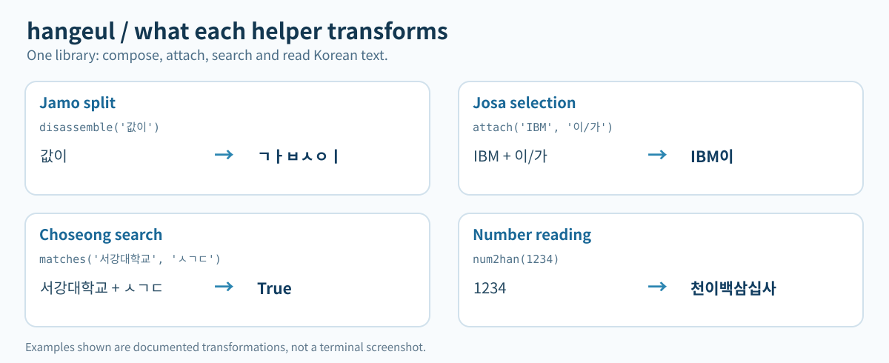

# hangeul

A dependency-free Python library (3.10+) for Korean text.

[](https://pypi.org/project/hangeul/)
[](https://pypi.org/project/hangeul/)
[](https://github.com/NaNIsaac/hangeul/actions/workflows/ci.yml)
[](https://github.com/NaNIsaac/hangeul/blob/main/LICENSE)

[한국어](README.ko.md)

`hangeul` covers jamo split and assembly (`ㄱㅏㅂㅅㅇㅣ` -> `값이`), particle (josa) selection that
handles numbers and acronyms (`IBM이`, `7로`), initial-consonant (choseong) search, jamo-level
similarity, and Korean number reading (`1234` -> `천이백삼십사`).



*Illustrative SVG, not a captured terminal session or measured experimental result.*

## Install

```bash
pip install hangeul
# or
uv add hangeul
```

Check that the install works. This command installs `hangeul` into a temporary environment and
imports it; it exits non-zero on failure.

<!-- test -->
```bash
uv run --no-project --with hangeul python -c "import hangeul"
```

You can also do a first run in one line.

<!-- test console -->
```console
$ uv run --no-project --with hangeul python -X utf8 -c "import hangeul as han; print(han.attach('IBM', '이/가'))"
IBM이
```

Termux is tested in CI.

## Quick start

```python
import hangeul as han

# Josa selection (digits, uppercase acronyms and parentheses are handled)
print(han.attach("IBM", "이/가"))  # IBM이
print(han.attach("SDK", "은/는"))  # SDK는
print(han.attach("7", "으로/로"))  # 7로
print(han.attach("애플(Apple)", "이/가"))  # 애플(Apple)이

# Jamo split and assembly
print(han.disassemble("값이"))  # ㄱㅏㅂㅅㅇㅣ
print(han.assemble("ㄱㅏㅂㅅㅇㅣ"))  # 값이

# Choseong search
print(han.matches("서강대학교", "ㅅㄱㄷ"))  # True
print(han.search_filter(["사과", "수박", "포도"], "ㅅㅂ"))  # ['수박']

# Jamo-level similarity (0.0 to 1.0)
print(han.similarity("값", "갑"))  # 0.75

# Reading numbers
print(han.num2han(1234567))  # 백이십삼만사천오백육십칠
```

## API

### Josa

| Function | Description |
| --- | --- |
| `get_josa(word, pattern)` | Returns the particle that follows `word`, chosen from `pattern` (for example `"이/가"` or `"으로/로"`). The order of the two forms in the pattern does not matter. |
| `attach(word, pattern)` | Returns `word` joined with the chosen particle. |

Supported patterns: 이/가, 은/는, 을/를, 와/과, 아/야, 나/이나, 란/이란, 랑/이랑, 라/이라,
예요/이에요, 로/으로, 로서/으로서, 로써/으로써, 로부터/으로부터. The `로` family picks `로` after a
ㄹ final consonant. Any other two-form pattern is read as `form after a final consonant / form
without one`. If the last character is a digit, it is read in Korean (일, 이, 삼...); if it is an
uppercase acronym, by letter names (에이, 비, 씨...). Lowercase English words count as having no final
consonant, and a trailing parenthesised part is ignored.

### Assembly and splitting

| Function | Description |
| --- | --- |
| `disassemble(text)` | Splits precomposed Hangul into jamo, including compound finals (`ㄳ`) and diphthongs (`ㅘ`). Other characters are left as they are. |
| `assemble(text)` | Assembles a jamo sequence into precomposed Hangul, handling compound finals, diphthongs and liaison. |
| `qwerty2han(text)` | Converts English keystrokes typed on a Dubeolsik layout into jamo (`"gksrmf"` -> `"ㅎㅏㄴㄱㅡㄹ"`). Together with `assemble` it recovers text typed with the wrong input mode. |

### Search and similarity

| Function | Description |
| --- | --- |
| `get_chosung(text)` | Extracts the initial consonant of each syllable (`"한글"` -> `"ㅎㄱ"`). |
| `matches(target, query, choseong_only=False)` | If the query consists only of initial consonants, compares choseong; otherwise does a jamo-level substring match. With `choseong_only=True` the query is reduced to its choseong first. |
| `search_filter(targets, query)` | Returns the list of items for which `matches` holds. |
| `similarity(str1, str2)` | Splits both strings into jamo and computes a similarity between 0.0 and 1.0 from the edit distance. |

### Character checks

| Function | Description |
| --- | --- |
| `is_han(text, allow_space=True, allow_punctuation=False)` | Checks that a string consists only of Hangul (precomposed syllables and compatibility jamo). Whether spaces and punctuation are allowed is configurable. |
| `is_pure_han(text)` | Checks that a string consists only of Hangul, with no spaces. |
| `has_batchim(char)` | Checks whether a syllable has a final consonant. |
| `can_cho(char)`, `can_jung(char)`, `can_jong(char)` | Check whether a jamo can stand in the initial, medial or final position. |

### Numbers

| Function | Description |
| --- | --- |
| `num2han(number)` | Converts a non-negative integer (or a numeric string with commas) to its Korean reading. `10000` becomes `"만"` and `100000000` becomes `"일억"`. |

### Constants

`CHOSOENG`, `JUNGSOENG`, `JONGSOENG`: tuples of the initial (19), medial (21) and final (28, the
first being an empty string) jamo, in Unicode syllable order.

## Development

```bash
uv run pytest
uv run ruff check .
```

See also: [hanfix](https://github.com/NaNIsaac/hanfix), a Rust CLI that reruns a command typed with
the wrong keyboard layout.

## License

MIT
